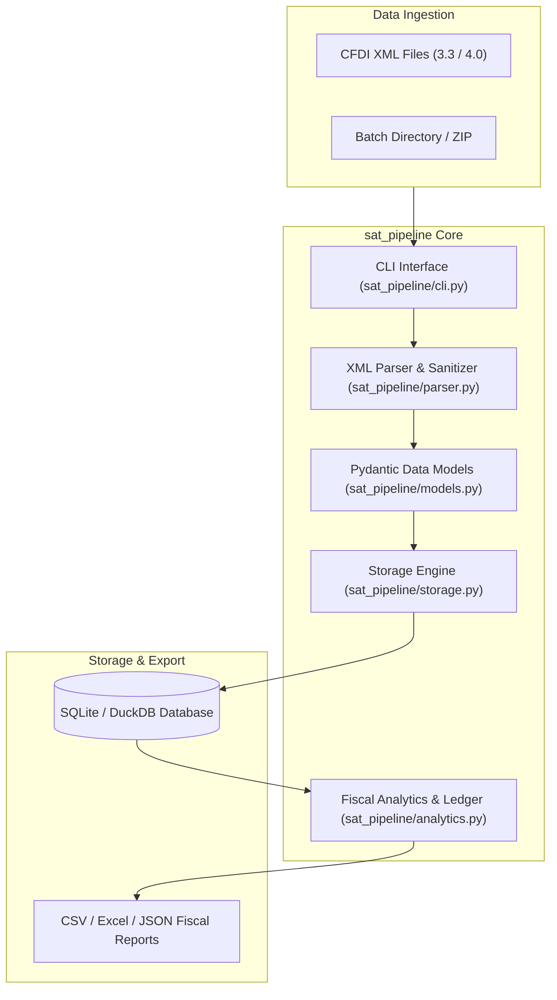
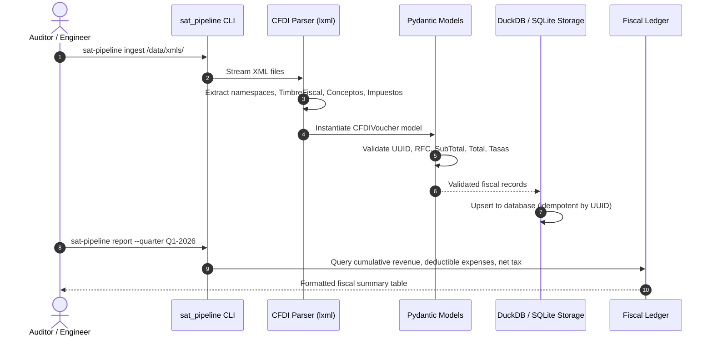

# 🏛️ SAT Data Pipeline Architecture & Topology

High-throughput, type-safe data extraction and analytical engine for Mexican Tax Authority (SAT) CFDI 3.3 and 4.0 XML vouchers. Built with Python 3.12, Pydantic, DuckDB, and SQLite.

---

## 1. Technology Stack

| Layer | Technology | Details |
| :--- | :--- | :--- |
| **Runtime** | Python 3.12+ | Native dataclasses, strict typing, match-case parsing |
| **Parsing & Validation** | `lxml` & `pydantic` | Fast XML element traversal, XML namespace resolution, schema validation |
| **Storage Engine** | SQLite / DuckDB | Embedded columnar and relational storage for local high-speed analytics |
| **Data Analytics** | `duckdb` & `pandas` | Analytical SQL queries over fiscal records (IVA, ISR, IEPS, retentions) |
| **CLI Framework** | `argparse` / `click` | Batch ingestion and terminal reporting interface |
| **Testing** | `pytest` | 100% test coverage over fiscal edge cases and malformed XMLs |

---

## 2. System Topology & Component Graph



---

## 3. Data Ingestion & Processing Lifecycle



---

## 4. Directory Structure & Module Breakdown

```
sat-data-pipeline/
├── sat_pipeline/             # Main Python package
│   ├── parser.py             # XML schema and namespace resolver for CFDI 3.3/4.0
│   ├── models.py             # Pydantic schemas (Voucher, Issuer, Receiver, Tax)
│   ├── storage.py            # SQLite/DuckDB relational database manager
│   ├── analytics.py          # Fiscal reconciliation, tax calculations, reports
│   └── cli.py                # Command-line interface for batch processing
├── tests/                    # Automated unit and integration test suite
│   ├── test_parser.py        # Parser assertions on sample vouchers
│   ├── test_storage.py       # Upsert, query, and constraint test cases
│   └── test_analytics.py     # Fiscal arithmetic and reconciliation tests
├── data/samples/             # Canonical test XML samples
├── pyproject.toml            # Project build configuration and dependencies
└── requirements.txt          # Python runtime requirements
```
